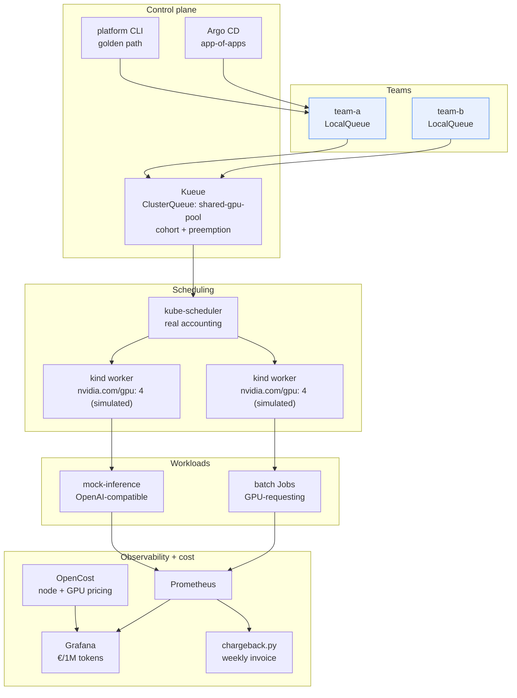

# Architecture

## Request path

1. A team submits a `Job` labelled `kueue.x-k8s.io/queue-name=default`.
2. Kueue admits it only if it fits the team's nominal quota (or can borrow from
   the cohort without starving another team), and creates a `Workload`.
3. The kube-scheduler places pods against **simulated but real-accounted**
   `nvidia.com/gpu` capacity.
4. The inference server emits `vllm:*` metrics; OpenCost emits node and GPU
   cost; Grafana joins them per team.
5. `chargeback.py` converts the same metrics into an invoice.

## Why the split between Kueue and ResourceQuota

They are not alternatives — they answer different questions.

| | `ResourceQuota` | Kueue `ClusterQueue` |
|---|---|---|
| Enforces | ceiling per namespace | fair-share policy across a shared pool |
| On breach | reject at admission, forever | queue, then admit when capacity frees |
| Borrowing | impossible | `cohort` + `borrowingLimit` |
| Preemption | none | priority-based eviction |
| Answers | "may you?" | "when?" |

Using only ResourceQuota gives you a platform where teams hoard quotas they
barely use and everyone runs at 15% utilisation. See `adr/0001`.
